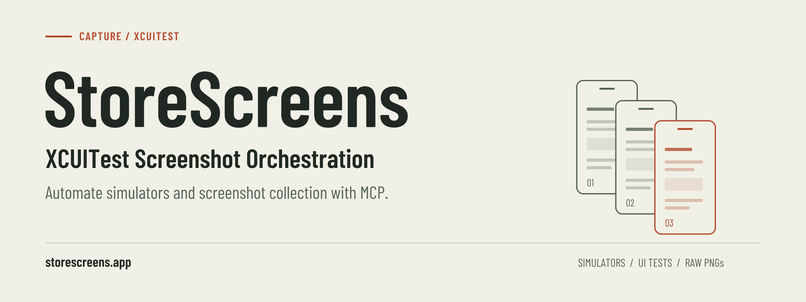

# StoreScreens capture skill

Agent instructions for [StoreScreens](https://github.com/ciscoriordan/storescreens-cli) version 4: simulator setup, XCUITest orchestration, and raw screenshot collection.

Use your preferred screenshot renderer and App Store Connect command-line tool. We recommend [Koubou](https://github.com/bitomule/Koubou) for screenshot composition and rendering, and [ASC CLI](https://asccli.sh/) for App Store Connect management and uploads. Neither is required for capture. Version 4 removes the former built-in renderer, App Store Connect client, and Wall of Apps functionality.

Install the CLI with mise, Homebrew, or the curl installer; see the [installation commands](https://github.com/ciscoriordan/storescreens-cli#install). This skill supplies agent instructions, not the CLI binary.

Install the skill from this repository using your agent's skill installer, or use the packaged `storescreens.skill`. Read [SKILL.md](SKILL.md) for the workflow and command boundaries.

Run `bash build-skill.sh` after changing the instructions or references. The build also synchronizes the XCUITest template from the sibling `storescreens-cli` checkout when available, so the generated tests and packaged skill use the same harness.

MIT.
